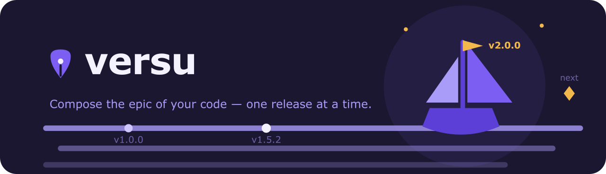

<!-- markdownlint-disable MD041 -->



<!-- markdownlint-enable MD041 -->

# @versu/plugin-node - Node.js Adapter Plugin

Node.js adapter plugin for Versu. Provides support for detecting and updating versions in Node.js projects, including npm, yarn and pnpm workspace monorepos.

## Installation

```bash
npm install @versu/core @versu/plugin-node
```

## Usage

Once installed, the plugin is discovered automatically from `node_modules` (or list it explicitly in the `plugins` array of your `versu.config.js`):

```typescript
import { VersuRunner } from "@versu/core";

const runner = new VersuRunner({
  repoRoot: "/path/to/repository",
  adapter: "node", // Optional - auto-detected
  // ...other options as needed
});

const result = await runner.run();
```

## Auto-Detection

The plugin automatically activates when `package.json` is present in the repository root.

## Workspace Support

Workspace members are discovered from:

- the `workspaces` field of the root `package.json` (npm / yarn, array or `{ packages: [] }` form), or
- `pnpm-workspace.yaml` (`packages` globs) when the root `package.json` declares no workspaces.

Projects without workspaces are handled as a single root module.

Dependencies between workspace packages (`dependencies`, `devDependencies`, `peerDependencies`, `optionalDependencies`) are used to build the dependency cascade: bumping a package also affects the packages that depend on it.

## Notes

### Version updates

- Module IDs use Gradle-style notation: `:` for the repository root and `:packages:core` for a nested workspace package.
- A module's `package.json` `version` is updated only when that module already declares one.
- Internal dependencies in `dependencies`, `devDependencies`, `peerDependencies`, and `optionalDependencies` are updated when they refer to a package whose version is changing. Simple version ranges keep their operator and `workspace:` prefix (for example, `^1.2.3` becomes `^2.0.0`, and `workspace:~1.2.3` becomes `workspace:~2.0.0`).
- Specs without a single concrete version are left unchanged. This includes `*`, `workspace:*`, `workspace:^`, `workspace:~`, `file:`, `link:`, git and URL specs, and compound ranges.

### Lockfile synchronization

After a manifest changes, the plugin synchronizes any matching lockfile that already exists. Workspace changes also check the shared repository-root lockfiles.

| Lockfile | Synchronization command |
| --- | --- |
| `package-lock.json`, `npm-shrinkwrap.json` | `npm install --package-lock-only --ignore-scripts --no-audit --no-fund` |
| `pnpm-lock.yaml` | `pnpm install --lockfile-only --ignore-scripts --no-frozen-lockfile` |
| `yarn.lock` (Yarn 3+) | `yarn install --mode=update-lockfile`, with immutable installs and lifecycle scripts disabled |
| `yarn.lock` (Yarn Classic / v1 or Yarn 2) | Full `yarn install`, because these versions do not provide lockfile-only mode; lifecycle scripts are disabled and lockfile updates are allowed |

The relevant package manager must be available on `PATH`. If synchronization fails, the update fails rather than leaving changed manifests with stale lockfiles. When more than one lockfile type is present, each matching updater runs; directories without that updater's lockfile are skipped.

## 📄 License

MIT License - see [LICENSE](LICENSE) for details.
